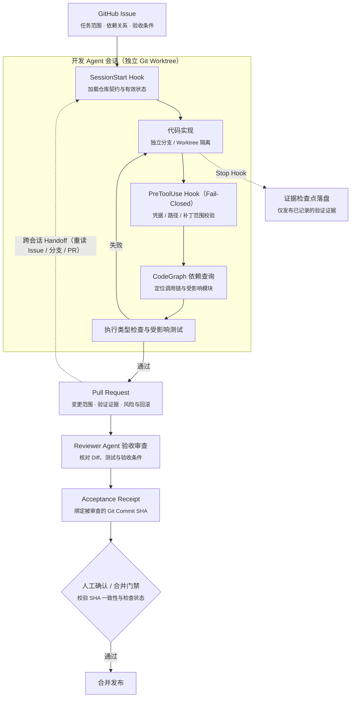
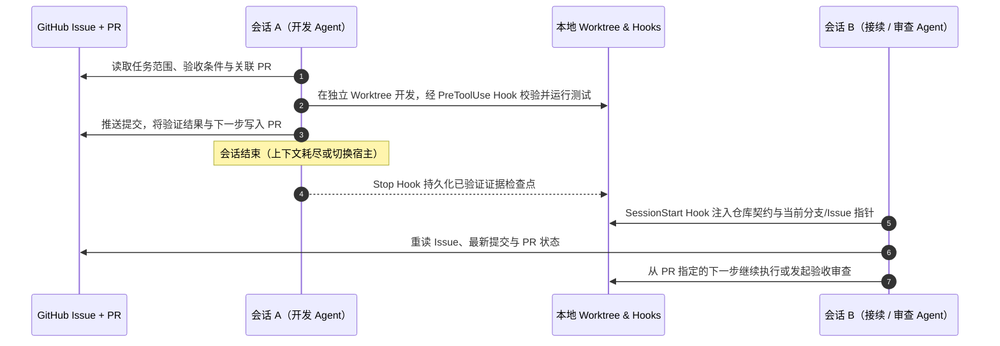

# kForge Harness

**多 Agent 软件交付框架（Multi-Agent Software Delivery Framework）**

[](https://bun.sh)
[](https://www.typescriptlang.org/)
[](#支持的-agent-宿主)
[](LICENSE)

`kForge Harness` 是一套面向代码仓库的多 Agent 软件交付框架，通过 CLI、确定性生命周期 Hook 与仓库内声明式契约，将 AI Coding Agent 的研发过程约束在可审计、可恢复、可验证的工程闭环中。

框架以 **GitHub Issue** 驱动开发、审查与验收：开发 Agent 在独立 **Git Worktree** 中执行改动，Reviewer Agent 依据验收条件核对代码差异与测试证据，生命周期 Hook 负责上下文加载、编辑边界拦截与证据落盘，关键交付节点由人工确认。

---

## 核心解决的问题

当 AI Coding Agent 的任务跨越多个会话、多个模块或并发分支时，纯对话模式会出现四类典型工程失效：

| 工程痛点 | kForge Harness 的解法 |
| --- | --- |
| **会话中断导致上下文丢失** | 以 GitHub Issue、分支与 PR 作为唯一事实源，通过标准化跨会话 Handoff 保留任务范围、已执行验证与下一步，新会话直接接续执行。 |
| **Agent 越界修改敏感或范围外文件** | 在工具调用前挂载确定性 `PreToolUse` 生命周期 Hook，采用 **Fail-Closed** 策略，拦截凭据访问、受保护目录与超范围写入。 |
| **旧验收结论被用于放行后续改动** | 执行证据（Verification Plan）与验收结论（Acceptance Receipt）职责分离，并将验收凭据严格绑定到被审查的 **Git Commit SHA**，提交变更即自动失效。 |
| **改动影响范围不明确，回归成本高** | 接入 **CodeGraph** 查询符号级调用链与模块依赖，辅助界定受影响模块与最小充分回归测试范围。 |

---

## 整体架构与交付闭环



### 跨会话 Handoff 流程

任务不依赖旧聊天记录恢复。任意新会话启动时，`SessionStart` Hook 从当前分支与仓库状态解析任务指针，直接从 Issue、分支与 PR 恢复上下文：



---

## 核心技术机制

### 1. 生命周期 Hook 路由与 Fail-Closed 安全守卫
- 用户级适配器将宿主事件统一路由到进程内单路由处理器（`src/cli/hook/route-registry.ts`），未接入框架的仓库自动静默退出。
- `PreToolUse` 阶段挂载多道安全守卫（`src/cli/hook/mutation-guard.ts`）：
  - `CredentialGuard`：拦截凭据与密钥文件读写。
  - `UserFileGuard`：阻止修改受保护目录（如 `_ops/`、`_ref/`）。
  - `EditScopeGuard` / `ApplyPatchScopeGuard`：校验目标路径是否在允许编辑范围内。
  - `RecursiveDeleteGuard`：拦截高危递归删除命令。
- 守卫默认采用 **Fail-Closed** 机制：当规则解析异常或路径无法判定安全时拒绝执行，并输出明确的 `[Guard]` 拦截原因与修复指令。

### 2. 独立 Worktree 并发隔离与跨会话 Handoff
- 每个开发与验收任务在独立 **Git Worktree** 中执行，避免多 Agent 并发开发时的工作区污染与索引锁冲突。
- 跨会话交接不写入脆弱的本地临时对话摘要，而是将任务范围、已完成检查、剩余风险与下一步操作沉淀到 GitHub Issue、Git 分支与 PR 中，保证跨会话、跨宿主（Codex / Claude / Pi）无损恢复。

### 3. 验收凭据与 Git Commit SHA 绑定
- 框架严格区分**执行证据（Execution Evidence）**与**验收凭据（Acceptance Receipt）**：测试通过仅证明命令执行过，不能替代验收放行。
- Reviewer Agent 在隔离检出环境中完成审查后生成结构化 `AcceptanceReceipt`（`src/core/review/acceptance-receipt.ts`），记录被审查提交的 `headSha` 与内容摘要。
- 合并门禁在放行前重新比对当前分支 `HEAD` 与验收凭据绑定的 Git Commit SHA；一旦审查后有新提交进入，旧凭据自动失效，防止未审查改动被放行。

### 4. 渐进式上下文与 CodeGraph 回归范围分析
- `SessionStart` 阶段仅加载精简的仓库级稳定上下文，编辑具体模块时再按需加载对应的能力契约（Capability Contract），控制 Token 开销。
- 接入 **CodeGraph**（`@colbymchenry/codegraph`）构建符号级依赖与调用图，在修改核心模块后快速查询上游调用方与下游依赖，辅助确定受影响模块清单与精准回归测试集。

### 5. 本地运维控制台与 MCP Sidecar
- **Operator Console**：仅监听本地回环地址（loopback）的 Web 看板，聚合展示任务阶段、待人工确认项、Worktree 状态与架构视图。
- **MCP Sidecar**：面向本地 MCP 客户端提供只读仓库状态与架构查询接口，默认不开放源码写权限。

---

## 技术栈

- **语言与运行时**：TypeScript、Bun (≥ 1.4.0)
- **Agent 集成**：Codex Hooks、Claude Hooks、Pi Extension、MCP SDK
- **版本控制与隔离**：Git Worktree、GitHub Issue / PR 工作流
- **代码分析与架构**：CodeGraph（符号调用链与依赖查询）、ArchContext
- **前端控制台**：React、Vite、Tailwind CSS、React Flow、Mermaid

---

## 支持的 Agent 宿主

| 宿主 | 接入方式 | 覆盖生命周期 |
| --- | --- | --- |
| **Codex** | `~/.codex/hooks.json` | SessionStart、PreToolUse（编辑/命令）、Subagent、Stop |
| **Claude** | `~/.claude/settings.json` | SessionStart、PreToolUse（编辑/命令）、Subagent、Stop |
| **Pi** | 内置 Extension (`src/pi/extension.ts`) | Session、Edit/Write、Bash、Stop |

---

## 项目目录结构

```text
.
├── src/
│   ├── cli/
│   │   ├── index.ts                # CLI 主入口
│   │   └── hook/                   # 生命周期 Hook 路由、上下文注入、变更守卫与 Stop 处理
│   ├── core/
│   │   ├── review/                 # 验收凭据 (Acceptance Receipt) 与 SHA 绑定校验
│   │   ├── evidence/               # 验证计划 (Verification Plan) 与执行证据模型
│   │   ├── adoption/               # 仓库初始化、契约校验与状态边界
│   │   └── architecture/           # 架构模型、模块依赖与重构信号分析
│   ├── effects/
│   │   └── review-runner/          # 隔离 Reviewer 执行宿主与多轮修复编排
│   ├── operator-web/               # 本地运维看板前端（React + Vite）
│   └── pi/                         # Pi 宿主扩展适配
├── assets/                         # 技能清单、参考配置模板与契约资源
├── scripts/                        # CI 检查、辅助工作流与基准评测脚本
├── references/                     # Handoff、Bot 控制边界与流程规范文档
├── docs/                           # 使用文档、架构文档与变更记录
└── tests/                          # 单元测试、集成测试与 Hook 轨迹回归测试
```

---

## 快速开始

### 环境要求
- Git
- [Bun](https://bun.sh) ≥ 1.4.0

### 本地安装与初始化

```bash
# 1. 克隆仓库并安装依赖
git clone https://github.com/123451123124/repo-harness.git kforge-harness
cd kforge-harness
bun install

# 2. 构建 Hook 单文件入口与 Review 宿主
bun run build:hook-bundle
bun run build:oar-review-host

# 3. 检查本地运行环境与宿主配置
bun src/cli/index.ts setup check

# 4. 在目标仓库中预览并初始化工作流契约
bun src/cli/index.ts init --dry-run
bun src/cli/index.ts init
```

### 常用命令速查

| 场景 | 命令 |
| --- | --- |
| 环境自检 | `rh setup check` |
| 仓库接入（预览 / 执行） | `rh init --dry-run` → `rh init` |
| 查看父级 Issue 任务看板 | `rh board --parent <issue> --json` |
| 启动本地运维控制台 | `rh operator serve` |
| 查看与清理已完成 Worktree | `rh worktrees list` → `rh worktrees clean --ids … --expected-digest …` |
| 发起 / 查看验收审查 | `rh review round\|status\|close …` |
| 校验验收凭据并合并 PR | `rh publication merge` |
| 查询架构模块与重构建议 | `rh arch module list --json` · `rh arch refactor recommendations` |
| 启动只读 MCP Sidecar | `rh mcp serve --repo . --profile planner` |

---

## 开发与验证

```bash
# TypeScript 静态类型检查
bun run check:type

# 运行核心测试集
bun run test:core

# 运行完整 CI 等效门禁
bun run check:ci
```

---

## 延伸文档

- 使用指南：[`docs/usage.md`](docs/usage.md)
- 跨会话 Handoff 规范：[`references/handoff.md`](references/handoff.md)
- 交付框架总览：[`docs/reference-configs/harness-overview.md`](docs/reference-configs/harness-overview.md)
- Hook 路由与守卫运维：[`docs/reference-configs/hook-operations.md`](docs/reference-configs/hook-operations.md)
- 外部工具集成（CodeGraph / ArchContext）：[`docs/reference-configs/external-tooling.md`](docs/reference-configs/external-tooling.md)

---

## License

MIT — 详见 [`LICENSE`](LICENSE)。
